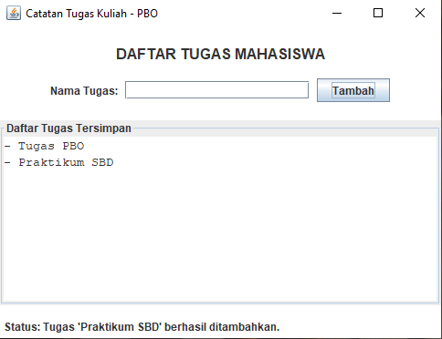

# Eksplorasi Java Swing GUI - Pemrograman Berorientasi Objek

**Nama:** Dahlia Wahyuni  
**NIM:** F1D02510047  

## Deskripsi Program
Program ini merupakan aplikasi desktop sederhana berbasis Java Swing untuk mencatat daftar tugas kuliah. Program ini mengimplementasikan 5 komponen/bagian utama arsitektur GUI Java:

1. **Top-Level Container Class (`JFrame`)**  
   Digunakan sebagai jendela utama aplikasi (`MainGUI extends JFrame`) yang menampung seluruh komponen antarmuka lainnya.
2. **Intermediate Container Class (`JPanel`)**  
   Digunakan untuk mengelompokkan komponen secara terstruktur menjadi tiga area: `panelAtas` (judul dan form), `panelInput` (input teks dan tombol), serta `panelBawah` (bar status).
3. **Atomic Component Class (`JLabel`, `JTextField`, `JButton`, `JTextArea`)**  
   Komponen dasar yang berinteraksi langsung dengan pengguna untuk menampilkan teks judul/status, menerima input nama tugas, memicu aksi tombol, dan menampilkan daftar tugas.
4. **Layout Classes (`BorderLayout`, `GridLayout`, `FlowLayout`)**  
   - `BorderLayout`: Mengatur tata letak utama pada `JFrame` (`NORTH`, `CENTER`, `SOUTH`).
   - `GridLayout`: Mengatur susunan vertikal pada `panelAtas`.
   - `FlowLayout`: Mengatur susunan horizontal tombol dan kolom input pada `panelInput` serta `panelBawah`.
5. **Event Listener (`ActionListener` & `KeyAdapter`)**  
   - Mengimplementasikan *interface* `ActionListener` dengan melakukan *override* metode `actionPerformed()` untuk menangani klik tombol **Tambah** dan **Bersihkan**.
   - Menggunakan *adapter class* `KeyAdapter` dengan melakukan *override* metode `keyPressed()` agar pengguna bisa menekan tombol **Enter** langsung pada `JTextField`.

## Screenshot Hasil Program
